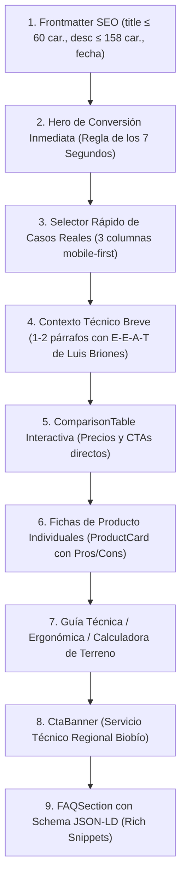

# Protocolo de Conversión y UX de HogarTV.cl: La Regla de los 7 Segundos

Este documento establece la **arquitectura obligatoria de contenido y CRO (Conversion Rate Optimization)** para todas las páginas y artículos de [HogarTV.cl](https://hogartv.cl).

---

## 🎯 ¿Qué es la "Regla de los 7 Segundos"?

El 80% del tráfico que llega a HogarTV.cl proviene de celulares (búsquedas orgánicas en Google o enlaces compartidos). **Un usuario móvil toma la decisión de quedarse o rebotar en los primeros 7 segundos** de entrar al sitio.

Si al abrir la página se encuentra con 4 párrafos de texto introductorio genérico ("En los últimos años la tecnología ha avanzado..."), el usuario se va. 

Para retenerlo y convertirlo en comprador de afiliados en tiempo récord:
1. **Above the Fold Inmediato:** El usuario debe ver en su pantalla, antes de hacer scroll, el **Producto #1 Ganador**, su precio en CLP verificado y un botón directo a Mercado Libre o Falabella.
2. **Respuesta Visual y Técnica:** Explicar en 3 viñetas concisas (qué es, para qué sirve en Chile y por qué es el mejor).
3. **Selector de Caso según el Usuario:** 3 tarjetas pequeñas para que el lector haga clic según su situación específica (ej. "Tengo TV antigua", "Tengo ventanal con mucho sol", "Vivo en casa de 2 pisos").

---

## 📐 Estructura Anatómica Obligatoria para Artículos (`src/content/articles/*.mdx`)

Cada artículo debe seguir esta secuencia exacta:



---

## 🧱 Plantilla de Componente Hero (7 Segundos)

```astro
{/* =========================================================================
    HERO DE CONVERSIÓN INMEDIATA (REGLA DE LOS 7 SEGUNDOS)
   ========================================================================= */}
<div class="my-4 sm:my-6 p-5 sm:p-7 rounded-3xl bg-gradient-to-b from-slate-900 via-surface-card to-slate-950 border-2 border-amber-400/60 shadow-2xl not-prose relative overflow-hidden">
  
  <div class="flex flex-wrap items-center justify-between gap-2 mb-4">
    <div class="inline-flex items-center gap-1.5 px-3 py-1 rounded-full bg-amber-400 text-slate-950 text-xs font-black uppercase tracking-wider shadow-sm">
      <span>🏆</span>
      <span>Recomendado #1 · La Elección de los Técnicos</span>
    </div>
    <span class="text-xs font-semibold text-emerald-400 flex items-center gap-1.5">
      <span class="inline-block w-2 h-2 rounded-full bg-emerald-400 animate-pulse"></span>
      Envío Full 24h a Todo Chile
    </span>
  </div>

  <div class="grid grid-cols-1 md:grid-cols-12 gap-6 items-center">
    
    <div class="md:col-span-4 flex justify-center">
      <div class="relative w-48 h-48 sm:w-56 sm:h-56 rounded-2xl bg-white p-3 border border-slate-200 flex items-center justify-center shadow-lg">
        <Image 
          src={productoPrincipalImg} 
          alt="Nombre del Producto Ganador"
          width={280}
          height={280}
          class="w-full h-full object-contain filter drop-shadow-md"
          loading="eager"
        />
      </div>
    </div>

    <div class="md:col-span-8 flex flex-col justify-center">
      <div class="flex items-center gap-1 text-amber-400 text-xs mb-1 font-semibold">
        <span>★★★★★</span>
        <span class="text-slate-300 ml-1">4.8/5 · El más vendido en Chile</span>
      </div>
      
      <h2 class="text-xl sm:text-2xl font-black text-white leading-tight mb-2">
        {Nombre del Producto y Modelo}
      </h2>

      <div class="flex flex-wrap items-baseline gap-3 mb-3">
        <span class="text-2xl sm:text-3xl font-black text-emerald-400">
          {preciosData['producto-key'].precioFormateado}
        </span>
        <span class="text-xs px-2.5 py-1 rounded-md bg-emerald-950/60 border border-emerald-500/40 text-emerald-300 font-semibold">
          ⚡ Despacho Inmediato
        </span>
      </div>

      <div class="space-y-1.5 text-xs sm:text-sm text-slate-200 mb-4 bg-slate-900/80 p-3.5 rounded-xl border border-slate-800">
        <div class="flex items-start gap-2">
          <span class="text-amber-400 font-bold shrink-0">🚀 Para qué sirve:</span>
          <span>Beneficio principal concreto y directo en 1 línea.</span>
        </div>
        <div class="flex items-start gap-2">
          <span class="text-emerald-400 font-bold shrink-0">🇨🇱 Probado en Chile:</span>
          <span>Compatibilidad con redes, voltaje 220V o aplicaciones chilenas.</span>
        </div>
        <div class="flex items-start gap-2">
          <span class="text-sky-400 font-bold shrink-0">💡 Por qué es el mejor:</span>
          <span>Razón técnica por la que supera a la competencia barata.</span>
        </div>
      </div>

      <div>
        <a 
          href={afiliadosData['producto-key'].url} 
          target="_blank" 
          rel="nofollow sponsored noopener noreferrer"
          class="w-full sm:w-auto inline-flex items-center justify-center gap-2 px-8 py-3.5 rounded-xl bg-yellow-400 hover:bg-yellow-300 text-slate-950 font-black text-sm uppercase tracking-wider shadow-xl shadow-yellow-500/25 transition-all transform hover:-translate-y-0.5 active:translate-y-0 text-center"
        >
          <span>👉 Ver Precio y Comprar en Mercado Libre</span>
          <span class="text-xs font-extrabold bg-slate-950/20 px-2 py-0.5 rounded">Envío Full</span>
        </a>
      </div>
    </div>
  </div>

  {/* Selector Rápido de Casos Reales (3 Tarjetas) */}
  <div class="mt-8 pt-6 border-t border-slate-800">
    <div class="flex items-center gap-2 mb-4">
      <span class="text-xl">🎯</span>
      <h3 class="text-sm sm:text-base font-extrabold text-white uppercase tracking-wide m-0">
        Identifica tu caso y elige la solución:
      </h3>
    </div>
    <div class="grid grid-cols-1 sm:grid-cols-3 gap-3.5">
      {/* Caso 1, 2 y 3 con enlaces ancla o compra directa */}
    </div>
  </div>
</div>
```

---

## ⚡ Reglas Estrictas para Agentes y Desarrolladores

1. **Nunca empezar un artículo con un muro de texto.** El Hero de 7 Segundos va inmediatamente debajo de los imports de MDX.
2. **Precios y Enlaces Centralizados:** Todos los precios deben llamarse desde `src/data/precios.json` y los enlaces desde `src/data/afiliados.json`. Prohibido quemar URLs o precios estáticos en el markdown.
3. **E-E-A-T Chileno Obligatorio:** Mencionar referencias reales de Chile (Mercado Libre Full, Falabella, Zapping, DGO, SUBTEL, SEC, voltaje 220V, regiones del país).
4. **FAQSection Obligatoria:** Toda página debe cerrar con preguntas frecuentes que generen Schema `FAQPage` para ganar los rich snippets de Google.
5. **Comprobación de Build:** Antes de subir a GitHub, ejecutar siempre `cmd.exe /c "cd /d C:\Users\DREAMFYRE 7\Desktop\TUVES PAG && npm run build"` y el script `node scripts/push-auto.cjs`.
