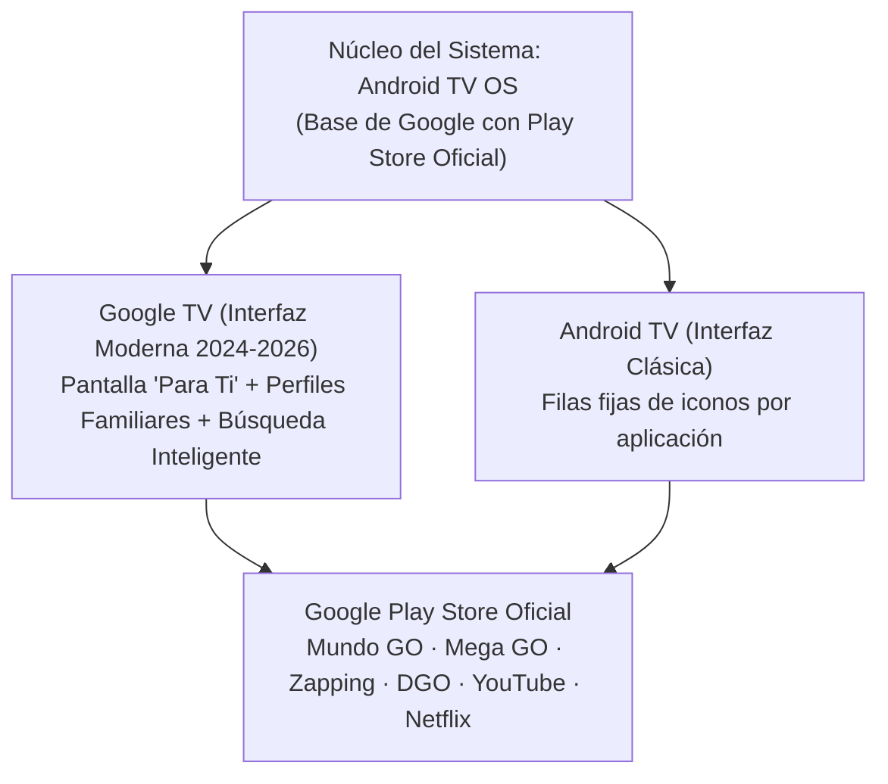

import { Image } from 'astro:assets';
import heroImg from '../../assets/smart-tv/google-tv-o-android-tv-chile-cual-conviene-smart-tv/hero.jpg';
import ProductCard from '../../components/ProductCard.astro';
import ComparisonTable from '../../components/ComparisonTable.astro';
import FAQSection from '../../components/FAQSection.astro';
import AdSlot from '../../components/AdSlot.astro';
import CtaBanner from '../../components/CtaBanner.astro';
import afiliadosData from '../../data/afiliados.json';
import preciosData from '../../data/precios.json';

import tclImg from '../../assets/smart-tv/mejores-smart-tv-calidad-precio-chile/tcl-c655-55.webp';
import hisenseImg from '../../assets/smart-tv/mejores-smart-tv-calidad-precio-chile/hisense-u6k-55.webp';
import xiaomiBoxImg from '../../assets/products/xiaomi-tv-box-s-4k.webp';
import chromecastImg from '../../assets/products/chromecast-google-tv.webp';

{/* =========================================================================
    HERO DE CONVERSIÓN RÁPIDA (RESPUESTA DIRECTA EN 10 SEGUNDOS)
   ========================================================================= */}

  {/* Imagen Hero 16:9 con Badges Flotantes */}
  

    <Image
      src={heroImg}
      alt="Comparativa entre Google TV y Android TV en Smart TV en Chile"
      width={1000}
      height={563}
      format="webp"
      quality={90}
      class="w-full h-full object-cover"
      loading="eager"
      fetchpriority="high"
    />
    

    

      
        📺 Guía Definitiva Chile 2026
      
      
        ✓ 100% Compatible con Mundo GO y Mega GO
      
    

    

      
        Sistemas Operativos de Televisores Inteligentes
      
      <h2 class="text-xl sm:text-2xl md:text-3xl font-black text-white leading-tight drop-shadow-md m-0">
        ¿Google TV o Android TV? Cuál Elegir y Qué Televisor Comprar
      </h2>
    

  

  {/* Resumen Directo en 30 Segundos */}
  

    

      <h3 class="text-base sm:text-lg font-black text-white m-0">
        Veredicto Rápido: ¿Cuál es la diferencia real entre ambos?
      </h3>
      

        <strong>Google TV es la versión moderna y mejorada de Android TV.</strong> No son sistemas rivales: ambos están creados por Google, usan la misma base de Android y tienen acceso a la <strong>misma tienda oficial Google Play Store</strong>. Sin embargo, Google TV es más rápido, organiza las películas y canales en una sola pantalla y es <strong>mucho más amigable y fácil de usar para adultos mayores</strong>.
      

    

    {/* Alerta Destacada sobre Mundo GO en Chile */}
    

      

        ⚠️
        <h4 class="font-extrabold text-amber-300 text-xs sm:text-sm m-0">
          ¿Buscas una Smart TV para usar la app Mundo GO en Chile?
        </h4>
      

      

        Muchos usuarios compran televisores Samsung (sistema Tizen), LG (webOS) o Roku y luego se llevan la gran sorpresa de que <strong>Mundo GO NO existe en sus tiendas de aplicaciones</strong>. Tanto <strong>Google TV como Android TV sí son 100% compatibles con la app oficial Mundo GO</strong> mediante Google Play Store, permitiendo ver todos los canales de cable por internet con solo encender la tele.
      

    

    

      <a
        href="#comparativa-directa"
        class="flex-1 min-w-[200px] py-3 px-5 rounded-xl bg-emerald-500 hover:bg-emerald-400 text-slate-950 font-black text-center text-xs uppercase tracking-wider transition-all shadow-lg shadow-emerald-500/25"
      >
        Ver Comparativa Detallada ↓
      </a>
      <a
        href="#televisores-recomendados"
        class="py-3 px-5 rounded-xl bg-slate-800 hover:bg-slate-700 text-slate-200 font-bold text-center text-xs transition-colors"
      >
        Ver Televisores Recomendados ↓
      </a>
    

  

---

## ¿Google TV o Android TV? La Verdad Técnica Detrás de Ambos

Una de las dudas más frecuentes en las tiendas chilenas al mirar televisores de marcas como **TCL, Hisense, Xiaomi o Philips** es encontrar cajas que dicen *"Android TV"* y otras que dicen *"Google TV"*.

Para entenderlo sin enredos técnicos:

* **Android TV** nació primero (en 2014) como la adaptación del sistema operativo de los celulares a los televisores. Su pantalla principal está organizada en **filas horizontales por cada aplicación** (una fila para YouTube, otra para Netflix, otra para Prime Video).
* **Google TV** se lanzó en 2020 y es la **nueva interfaz inteligente de Google**. Por debajo sigue funcionando con el motor de Android, pero su pantalla principal no te obliga a entrar app por app: te muestra directamente las películas, series y canales en vivo que estabas viendo o que te recomienda según tus gustos personales.

### Tabla Comparativa Directa: Google TV vs. Android TV

<ComparisonTable
  title="Google TV vs. Android TV: Duelo de Características en Chile"
  headers={["Característica", "Google TV (Moderno)", "Android TV (Clásico)"]}
  rows={[
    { feature: "Tipo de Interfaz", values: ["Centrada en el contenido ('Para ti') con portada interactiva", "Centrada en filas de aplicaciones individuales"] },
    { feature: "Tienda de Aplicaciones", values: ["Google Play Store para TV (+10.000 aplicaciones)", "Google Play Store para TV (+10.000 aplicaciones)"] },
    { feature: "Compatibilidad Mundo GO y Mega GO", values: ["✓ 100% Compatible y certificada", "✓ 100% Compatible y certificada"] },
    { feature: "Facilidad de Uso para Adultos Mayores", values: ["Excelente: Íconos grandes, control por voz rápido y accesos directos", "Buena: Menú más espartano en filas horizontales"] },
    { feature: "Búsqueda por Voz (Google Assistant)", values: ["Ultra rápida en español chileno con sugerencias precisas", "Básica (búsqueda dentro de aplicaciones seleccionadas)"] },
    { feature: "Perfiles de Usuario Independientes", values: ["Sí (perfil por persona + perfil exclusivo para niños)", "No (un solo perfil general para toda la casa)"] },
    { feature: "Modo 'Televisor Básico' (Sólo Canales)", values: ["Sí (ideal si no quieres que adultos mayores se confundan)", "No disponible"] },
    { feature: "Presencia en Televisores Nuevos 2026", values: ["Estándar actual en TCL, Hisense, Xiaomi y Philips", "Presente solo en modelos antiguos o TV boxes económicos"] }
  ]}
  verdict="Google TV es el claro ganador para comprar hoy: ofrece la misma libertad de aplicaciones de Android TV pero con una interfaz mucho más fluida, moderna y pensada para que cualquier persona en la familia pueda navegar sin complicaciones."
/>

---

## La Razón Clave en Chile: Compatibilidad con Mundo GO, Mega GO y TV Nacional

En Chile existe un fenómeno muy particular que motiva a miles de personas a buscar específicamente un televisor con **Google TV o Android TV**: la aplicación **Mundo GO**.

### ¿Qué es Mundo GO y por qué genera tantos problemas en otras marcas?

**Mundo Telecomunicaciones (antes Mundo Pacífico)** es la compañía de fibra óptica con mayor crecimiento en comunas rurales y regiones de Chile (Región Metropolitana periférica, O'Higgins, Maule, Ñuble, Biobío, Los Lagos, etc.). Al contratar su servicio, la empresa entrega acceso a su plataforma **Mundo GO**, que permite ver más de 100 canales de televisión por cable en vivo (incluyendo señales chilenas como Mega, CHV, Canal 13, TVN, además de canales infantiles, de noticias y deportes como TNT Sports o ESPN).

El problema radica en que muchas personas compran un televisor guiándose solo por la marca conocida:

| Marca de Smart TV | Sistema Operativo | ¿Tiene la App Mundo GO Oficial? | ¿Tiene Mega GO y Zapping? |
| :--- | :--- | :--- | :--- |
| **TCL / Hisense / Xiaomi / Philips** | **Google TV o Android TV** | **✅ SÍ (En Google Play Store)** | **✅ SÍ (100% Compatibles)** |
| **Samsung** | Tizen OS | ❌ NO disponible nativamente | ⚠️ Mega GO sí, Mundo GO NO |
| **LG** | webOS | ❌ NO disponible nativamente | ⚠️ Zapping sí, Mundo GO NO |
| **Roku TV** (AOC, RCA, Philips Roku) | Roku OS | ❌ NO disponible nativamente | ⚠️ Solo Zapping; Mundo GO NO |

> **⚠️ Atención:** Si compras una Smart TV Samsung o LG con la intención de instalar Mundo GO para un familiar o adulto mayor, te encontrarás con que **la aplicación no existe en sus tiendas propietarias**. Para tener Mundo GO garantizado sin trucos raros, **el televisor debe tener Google TV o Android TV**.

---

## Diseñado para Adultos Mayores: Cómo Configurar Mundo GO para que no se Confundan

Una de las mayores preocupaciones al comprarle un televisor a una persona de la tercera edad o a familiares del campo es: *"No quiero que la tele sea complicada y no puedan poner los canales"*.

Con **Google TV**, la configuración es sumamente limpia y se resuelve en solo 3 minutos:

1. **Fijar Mundo GO como Primera Aplicación:**  
   En la pantalla de inicio de Google TV, mantén presionado el botón central sobre el ícono de Mundo GO y muévelo al **primer lugar de la fila de 'Mis Aplicaciones'**. De esta manera, cada vez que el adulto mayor encienda el televisor, solo tiene que presionar **un solo botón en el control remoto** y la televisión por cable se abrirá al instante.
2. **Control por Voz con Micrófono en Español:**  
   Los controles remotos de televisores con Google TV incluyen un botón con el logo de micrófono de Google. La persona solo debe mantener presionado el botón y decir:  
   👉 *"Abrir Mundo GO"*  
   👉 *"Poner Mega GO"*  
   👉 *"Noticias en YouTube"*  
   El televisor abrirá el canal o la aplicación de inmediato sin necesidad de escribir letra por letra.
3. **Modo 'Solo Aplicaciones' o Cuenta Limpia:**  
   En los ajustes de Google TV se puede activar el modo simplificado para ocultar recomendaciones publicitarias y dejar únicamente una barra con los íconos indispensables: **Mundo GO, YouTube y Netflix**.

---

## Los Mejores Smart TV con Google TV Recomendados en Chile (2026)

Si vas a renovar la tele de tu casa o quieres regalarle una pantalla a tus padres o abuelos que sea rápida, moderna y 100% compatible con **Mundo GO, Mega GO, Zapping y DGO**, estos son los modelos más recomendados y con mejor respaldo técnico en el país:

### 1. TCL Serie C655 / P755 / T6D: El Rey Calidad-Precio con Google TV

TCL es el fabricante que mejor implementa **Google TV oficial** en Chile. Su sistema vuela en velocidad, incluye control remoto ergonómico con botón de voz de Google y sus pantallas utilizan tecnología **QLED** con colores vivos y gran nivel de brillo para que se vea claro incluso de día.

<ProductCard
  productKey="tcl-c655-55"
  isFirst={true}
  title='Smart TV TCL 55" 4K QLED con Google TV (Línea C655 / T6D)'
  brand="TCL"
  badge="🏆 La Mejor Opción con Google TV en Chile"
  specs={[
    "55 Pulgadas 4K Ultra HD",
    "Panel QLED Quantum Dot",
    "Google TV Oficial con Play Store",
    "Control Remoto con Micrófono Google Assistant",
    "Compatible con Mundo GO, Mega GO y Zapping",
    "WiFi Dual Band 2.4 / 5 GHz"
  ]}
  pros={[
    "Google TV oficial de fábrica: instalas Mundo GO en 1 minuto desde la Play Store",
    "Control remoto simple y con micrófono para abrir canales con la voz",
    "Pantalla QLED brillante ideal para ver fútbol y noticias de día",
    "Disponible también en versiones de 43, 50 y 65 pulgadas para cualquier habitación"
  ]}
  cons={[
    "El audio integrado es estándar; si buscas sonido de cine conviene sumar barra de sonido"
  ]}
  tiendas={[
    {
      tienda: "Mercado Libre Chile",
      precio: preciosData['tcl-c655-55'].precioFormateado,
      badge: "🔥 Envío Rápido",
      destacada: true,
      envio: "Envío Gratis a Domicilio",
      urlKey: "tcl-c655-55"
    },
    {
      tienda: "Falabella Chile (Modelo T6D QLED)",
      precio: "$ 359.990 CLP",
      badge: "Retail Oficial",
      destacada: false,
      envio: "Despacho o Retiro en Tienda",
      url: "https://creators.falabella.com/-5xdD"
    }
  ]}
/>

---

### 2. Hisense U6K / U7K: Máximo Brillo Mini-LED con Google TV

Si tu televisor estará en un living con ventanales grandes donde entra mucho sol, la línea **U6K de Hisense** con Google TV ofrece iluminación **Mini-LED**, entregando negros profundos y una potencia de luz superior para que nadie tenga que forzar la vista.

*(Ojo al comprar Hisense en tiendas: asegúrate de que la caja diga **Google TV**, ya que los modelos más básicos de la marca vienen con el sistema VIDAA, el cual no tiene Mundo GO).*

<ProductCard
  productKey="hisense-u6k-55"
  title='Smart TV Hisense 55" Mini-LED ULED 4K con Google TV (U6K)'
  brand="Hisense"
  badge="☀️ El Más Brillante para Livings Iluminados"
  specs={[
    "55 Pulgadas 4K Mini-LED ULED",
    "Atenuación Local (Local Dimming)",
    "Google TV Oficial",
    "Dolby Vision & Dolby Atmos",
    "Play Store con Mundo GO y Mega GO",
    "Control por Voz Integrado"
  ]}
  pros={[
    "Brillo potente que elimina los reflejos de ventanas de día",
    "Google TV fluido con acceso a todas las plataformas chilenas",
    "Negros profundos gracias a sus zonas de atenuación Mini-LED"
  ]}
  cons={[
    "Precio ligeramente más alto que los modelos LED tradicionales",
    "Debes verificar que el modelo traiga Google TV y no VIDAA OS"
  ]}
  tiendas={[
    {
      tienda: "Mercado Libre Chile",
      precio: preciosData['hisense-u6k-55'].precioFormateado,
      badge: "🔥 Mejor Oferta",
      destacada: true,
      envio: "Envío Gratis a Todo Chile",
      urlKey: "hisense-u6k-55"
    },
    {
      tienda: "Falabella Chile (Hisense U6 Mini-LED)",
      precio: "$ 429.990 CLP",
      badge: "Retail Oficial",
      destacada: false,
      envio: "Despacho o Retiro",
      url: "https://creators.falabella.com/-5xdR"
    }
  ]}
/>

---

## ¿Ya Tienes un Televisor Samsung, LG o Antiguo? La Solución Barata con TV Box

Si en tu casa ya tienes un televisor funcionando perfecto pero tiene un sistema cerrado (Samsung Tizen, LG webOS o una tele antigua sin internet), **no necesitas gastar $300.000 en una pantalla nueva**.

La solución más inteligente y económica es conectar un pequeño reproductor por el puerto **HDMI**, transformando de inmediato cualquier televisor en un **Google TV completo**:

  {/* Opción 1: Xiaomi TV Box S 2nd Gen */}
  

    

      

        Recomendado N°1 Calidad / Precio
      

      <h3 class="text-base sm:text-lg font-black text-white m-0">
        Xiaomi TV Box S (2nd Gen) 4K con Google TV
      </h3>
      

        Se conecta al HDMI de cualquier tele Samsung, LG o antigua. Trae **Google TV oficial con Play Store**, control Bluetooth con comando de voz, puerto USB para ver fotos o videos y conexión WiFi rápida.
      

      

        ✓ Compatible al 100% con Mundo GO, Mega GO, Zapping y DGO
      

    

    

      
        {preciosData['xiaomi-tv-box-s-4k'].precioFormateado}
      
      <a
        href={afiliadosData['xiaomi-tv-box-s-4k'].url}
        target="_blank"
        rel="noopener noreferrer"
        class="px-4 py-2 rounded-xl bg-emerald-500 hover:bg-emerald-400 text-slate-950 font-black text-xs uppercase tracking-wider transition-all"
      >
        Ver en M. Libre →
      </a>
    

  

  {/* Opción 2: Chromecast con Google TV */}
  

    

      

        Ultra Compacto
      

      <h3 class="text-base sm:text-lg font-black text-white m-0">
        Google Chromecast con Google TV (HD / 4K)
      </h3>
      

        El dispositivo original de Google. Queda completamente oculto detrás del televisor, incluye control remoto con volumen y encendido que puede reemplazar al control original de la tele.
      

      

        ✓ Ideal para televisores colgados a la pared
      

    

    

      
        {preciosData['chromecast-google-tv'].precioFormateado}
      
      <a
        href={afiliadosData['chromecast-google-tv'].url}
        target="_blank"
        rel="noopener noreferrer"
        class="px-4 py-2 rounded-xl bg-slate-800 hover:bg-slate-700 text-slate-200 font-bold text-xs transition-colors"
      >
        Ver en M. Libre →
      </a>
    

  

---

## Cómo Instalar y Activar Mundo GO Paso a Paso en tu Smart TV

Si ya compraste tu televisor o TV Box con Google TV o Android TV, sigue estos sencillos pasos para dejar los canales de cable funcionando:

1. **Conecta tu cuenta de Google:** Al encender el televisor por primera vez, vincula cualquier cuenta de Gmail para activar la tienda Google Play Store.
2. **Entra a la pestaña de Aplicaciones:** En la parte superior de la pantalla, ve a la sección **'Apps'** o abre el ícono de **Google Play Store**.
3. **Busca 'Mundo GO':** En el buscador escribe *"Mundo GO"* (o presiona el botón de voz del control y dilo en voz alta).
4. **Instalar y Abrir:** Presiona **'Instalar'**. La aplicación se descargará en menos de 20 segundos.
5. **Iniciar Sesión:** Abre la app e ingresa con el usuario y contraseña que te proporcionó Mundo Telecomunicaciones (suele ser el RUT del titular y la clave asignada).
6. **Fijar en Favoritos:** Vuelve a la pantalla principal de la tele, busca el ícono de Mundo GO y muévelo a la primera posición para que esté siempre a mano.

---

export const tvFaqs = [
  {
    question: "¿Es mejor comprar una tele con Google TV o con Android TV en 2026?",
    answer: "Conviene elegir Google TV. Aunque ambos tienen la misma tienda Play Store y ejecutan las mismas aplicaciones (incluyendo Mundo GO y Mega GO), Google TV es el sistema que reemplazó a Android TV, por lo que recibe actualizaciones más frecuentes, tiene una interfaz mucho más moderna y es más fácil de usar para toda la familia."
  },
  {
    question: "¿Por qué no puedo instalar Mundo GO en mi Smart TV Samsung o LG?",
    answer: "Porque Samsung utiliza su propio sistema operativo llamado Tizen, y LG utiliza webOS. Ambas marcas tienen tiendas cerradas de aplicaciones y los desarrolladores de Mundo GO crearon la app exclusivamente para el ecosistema Android TV / Google TV. Para tener Mundo GO en una tele Samsung o LG, debes conectarle un TV Box como el Xiaomi TV Box S o un Chromecast por HDMI."
  },
  {
    question: "¿Mundo GO funciona en televisores con sistema Roku?",
    answer: "No de forma oficial. El sistema Roku OS no dispone de la aplicación Mundo GO en su tienda de canales en Chile. Si tienes una tele con Roku y necesitas Mundo GO, la única solución es agregar un reproductor con Google TV."
  },
  {
    question: "¿Qué otras aplicaciones chilenas funcionan en Google TV?",
    answer: "En Google TV y Android TV puedes instalar todas las aplicaciones de streaming chilenas disponibles en el mercado: Mega GO, Zapping, DGO (DirecTV), Entel TV, Movistar TV, Pluto TV Chile, 13 GO, TVN Play y Estadio TNT Sports."
  },
  {
    question: "¿Qué tamaño de Smart TV con Google TV conviene para una persona mayor?",
    answer: "Para un dormitorio, los tamaños de 40 a 43 pulgadas (como la serie TCL S5400 o C655) son los más recomendados: tienen una pantalla amplia para leer los textos y menús de las noticias sin cansar la vista y caben cómodamente en cualquier mueble o soporte de muro."
  }
];

## Preguntas Frecuentes sobre Google TV, Android TV y Apps en Chile

<FAQSection
  title="Dudas Frecuentes sobre Televisores y Compatibilidad de Apps"
  items={tvFaqs}
/>

---

<CtaBanner
  title="¿Buscas una Smart TV rápida y compatible con todos los canales en Chile?"
  subtitle="Revisa las mejores ofertas del día en televisores TCL y Hisense con Google TV oficial en Mercado Libre y Falabella con despacho directo a todo el país."
  ctaText="Ver Ofertas de Smart TV en Chile →"
  ctaUrl="/ofertas-tv-chile/"
/>
