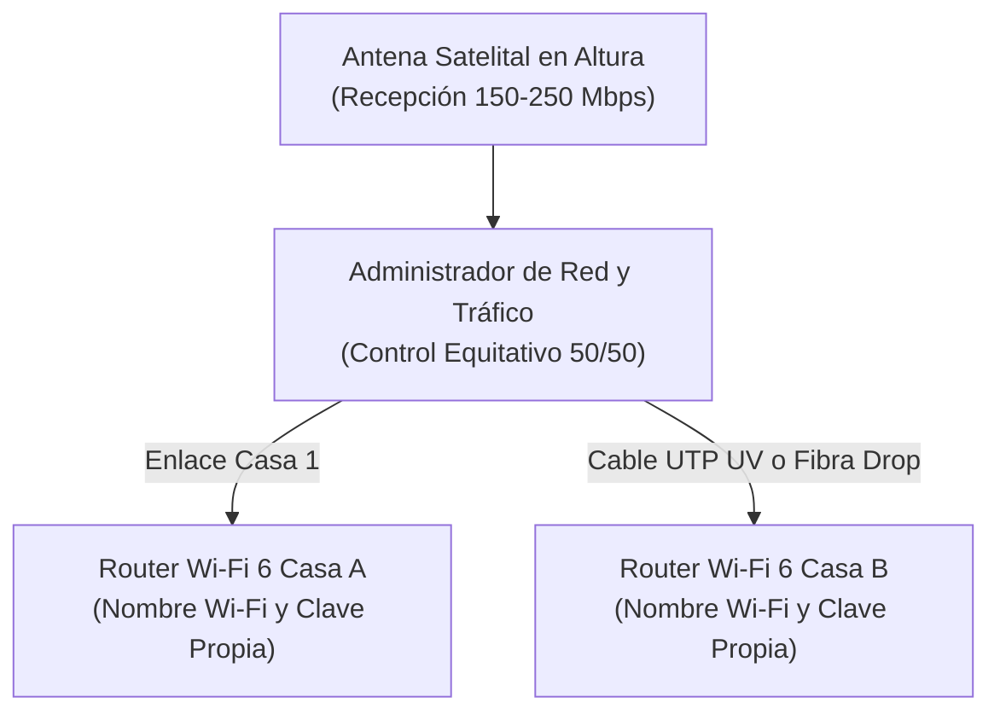

import { Image } from 'astro:assets';
import heroImage from '../../assets/accesorios/instalacion-internet-satelital-rural-chile-redes-parcelas/hero.jpg';
import FAQSection from '../../components/FAQSection.astro';

{/* =========================================================================
    1. NOTA PRINCIPAL CON IMAGEN (IMPACTO VISUAL · 8ª REGIÓN)
   ========================================================================= */}

  {/* Imagen Hero 16:9 con Badges Flotantes */}
  

    <Image
      src={heroImage}
      alt="Instalación profesional de antena satelital en parcela rural de la Región del Biobío, Chile"
      width={1000}
      height={563}
      format="webp"
      quality={90}
      class="w-full h-full object-cover"
      loading="eager"
      fetchpriority="high"
    />
    

    

      
        📍 Servicio en Terreno · Región del Biobío
      
      
        ⚡ 100 a 250 Mbps Reales
      
    

    

      
        Conectividad de Alta Velocidad para Parcelas y Zonas Rurales
      
      <h2 class="text-xl sm:text-2xl md:text-3xl font-black text-white leading-tight drop-shadow-md m-0">
        Instalación Profesional de Internet Satelital en la 8ª Región
      </h2>
    

  

  {/* Resumen Directo y Botones de Acción */}
  

    

      <h3 class="text-base sm:text-lg font-black text-white m-0">
        ¿Vives en una parcela o sector rural donde no llega la fibra y el 4G se satura por las tardes?
      </h3>
      

        Realizamos visitas técnicas, montaje en altura, enlaces entre casas vecinas y conexión de cámaras lejanas en <strong>Florida, Yumbel, Santa Juana, Quillón, Concepción, Cabrero, Los Ángeles</strong> y alrededores.
      

    

    

      <a
        href="https://wa.me/56931926886?text=Hola%20Luis,%20quiero%20cotizar%20la%20instalación%20de%20internet%20satelital%20en%20mi%20parcela."
        target="_blank"
        rel="noopener noreferrer"
        class="w-full sm:w-auto flex-1 py-3.5 px-6 rounded-xl bg-emerald-500 hover:bg-emerald-400 text-slate-950 font-black text-center text-xs sm:text-sm uppercase tracking-wider shadow-lg shadow-emerald-500/25 transition-all flex items-center justify-center gap-2"
      >
        📲 Consultar Factibilidad por WhatsApp (+56 9 3192 6886)
      </a>
      <a
        href="#guia-facil"
        class="w-full sm:w-auto py-3.5 px-5 rounded-xl bg-slate-800 hover:bg-slate-700 text-slate-200 font-bold text-center text-xs transition-colors"
      >
        Ver Guía Fácil ↓
      </a>
      <a
        href="#modalidades-servicio"
        class="w-full sm:w-auto py-3.5 px-5 rounded-xl bg-slate-800/80 hover:bg-slate-700 text-emerald-300 border border-emerald-500/30 font-bold text-center text-xs transition-colors"
      >
        Modalidades y Cotización ↓
      </a>
    

    {/* Aviso legal discreto al pie del bloque */}
    

      ⚖️ <em>Aviso legal: HogarTV.cl y Luis Briones prestan servicios técnicos independientes de ingeniería de redes, montaje y cableado. Starlink® es marca registrada de SpaceX. La cuota mensual oficial es contratada directamente por el titular con el proveedor.</em>
    

  

---

{/* =========================================================================
    2. GUÍA FÁCIL: RESUMEN PRÁCTICO Y CLARO DEL SERVICIO
   ========================================================================= */}

  

    
      ✨ Guía Fácil · Paso a Paso
    
    
      Servicio 100% Llave en Mano
    
  

  <h2 class="text-xl sm:text-2xl font-black text-white leading-tight mb-2 m-0">
    Guía Fácil: ¿Cómo Funciona Nuestro Servicio?
  </h2>
  

    Nos encargamos de toda la instalación física y configuración para que tengas internet de alta velocidad en tu casa o parcela desde el primer día, sin complicaciones:
  

  

    {/* Punto 1 */}
    

      

        🪜
      

      

        <h3 class="text-sm sm:text-base font-extrabold text-white m-0">
          1. Montaje Seguro en Altura
        </h3>
        

          Instalamos la antena en el techo sobre un mástil firme de acero para superar árboles y obstáculos. Llevamos todas las herramientas, soportes y fijaciones de intemperie para que no tengas que subirte al techo.
        

      

    

    {/* Punto 2 */}
    

      

        📶
      

      

        <h3 class="text-sm sm:text-base font-extrabold text-white m-0">
          2. Wi-Fi Potente en Toda la Casa
        </h3>
        

          Entramos el cableado de forma limpia e instalamos un <strong>Router Wi-Fi 6 de largo alcance</strong> en el interior. Dejamos tus Smart TV, teléfonos y computadores conectados y probados para videollamadas, trabajo y streaming 4K.
        

      

    

    {/* Punto 3 */}
    

      

        🤝
      

      

        <h3 class="text-sm sm:text-base font-extrabold text-emerald-300 m-0">
          3. Opción de Compartir 50/50 con tu Vecino
        </h3>
        

          Si tienes un vecino o familiar en una casa cercana, podemos conectar ambas viviendas a una sola antena mediante cable exterior o fibra óptica para que <strong>dividan la mensualidad a la mitad</strong>, cada uno con su propia red y clave privada.
        

      

    

    {/* Punto 4 */}
    

      

        📹
      

      

        <h3 class="text-sm sm:text-base font-extrabold text-indigo-300 m-0">
          4. Conexión de Cámaras Lejanas (Portón u Otros Puntos)
        </h3>
        

          Si necesitas vigilar el portón de entrada, un galpón o bodega lejos de la casa, llevamos internet hasta ese punto mediante <strong>Inyector PoE (hasta 100m)</strong> o <strong>fibra óptica drop (más de 100m)</strong> para que veas la cámara en vivo desde tu celular.
        

      

    

  

---

{/* =========================================================================
    3. MODALIDADES DE INSTALACIÓN, CÁMARAS LEJANAS Y COTIZACIÓN
   ========================================================================= */}

## Modalidades de Instalación y Soluciones en Terreno

Elige la alternativa que mejor se adapte a tu parcela, a la distancia con tu vecino o a los puntos de vigilancia que necesites conectar:

  

    

      Modalidad 1
    

    <h3 class="text-base font-extrabold text-white m-0">🏡 Parcela Individual</h3>
    

      Para una sola vivienda. Incluye montaje de antena en mástil elevado para librar copas de árboles, cableado exterior protegido y <strong>Router Wi-Fi 6 de alta cobertura</strong> para atravesar muros interiores.
    

    
✓ Cobertura total en dormitorios y living

  

  

    

      Modalidad 2 · Más Solicitada
    

    <h3 class="text-base font-extrabold text-white m-0">🤝 Compartido Vecinos (UTP)</h3>
    

      Para 2 casas contiguas separadas por <strong>hasta 80 metros</strong>. Una sola antena alimenta ambas viviendas mediante <strong>cable de red exterior blindado con doble chaqueta UV</strong> y 2 Routers Wi-Fi 6 independientes.
    

    
✓ Dividen el costo mensual a la mitad (50/50)

  

  

    

      Modalidad 3 · Larga Distancia
    

    <h3 class="text-base font-extrabold text-white m-0">🌲 Compartido Largo (Fibra Drop)</h3>
    

      Para parcelas separadas entre <strong>100 y 500 metros</strong> cruzando caminos o bosque. Tendemos <strong>fibra óptica drop monomodo dieléctrica</strong> con conversores ópticos: inmune a rayos y sin pérdida de velocidad.
    

    
✓ 100% de velocidad a larga distancia

  

{/* Módulo Especial: Cámara Lejana (Portón u Otros Puntos) */}

  

    

      
        📹 SEGURIDAD PERIMETRAL
      
      <h3 class="text-base sm:text-lg font-black text-white m-0">
        Cámara Lejana (Portón de Entrada u Otros Puntos)
      </h3>
    

    Solución PoE / Fibra Drop
  

  

    Si necesitas instalar o conectar una cámara lejos de la casa principal (en el <strong>portón de entrada, tranquera, galpón, bodega o quincho</strong>), resolvemos la señal de internet y la alimentación eléctrica según los metros de distancia:
  

  

    

      

        <h4 class="font-bold text-white text-xs sm:text-sm m-0">🔌 Hasta 100 Metros: Con Inyector PoE desde la Casa</h4>
        Hasta 100m
      

      

        Hasta 100 metros de distancia, instalamos <strong>cable UTP exterior blindado UV</strong> e incorporamos un <strong>Inyector PoE (Power over Ethernet) dentro de tu casa</strong>. El mismo cable de red lleva internet y energía eléctrica hasta la cámara, por lo que <strong>no necesitas tener enchufe ni corriente de 220V en el portón</strong>.
      

    

    

      

        <h4 class="font-bold text-white text-xs sm:text-sm m-0">⚡ Más de 100 Metros: Fibra Drop + Inyector PoE en el Punto</h4>
        + de 100m
      

      

        A más de 100 metros (ej. 150m a 500m), el cable de cobre pierde voltaje. En este caso tiramos una <strong>línea de fibra óptica drop dedicada</strong> para llevar la señal sin pérdida y colocamos el conversor óptico junto a un <strong>Inyector PoE con alimentación eléctrica en el mismo punto de la cámara</strong> (conectado a la corriente del portón eléctrico, caseta, galpón o kit solar).
      

    

  

### Tabla Resumen para Cotizar tu Proyecto

Cada parcela tiene condiciones distintas (altura de árboles, distancia en metros y tipo de techumbre), por lo que elaboramos un **presupuesto a medida** según los materiales y metros requeridos:

| Servicio / Modalidad | Qué Incluye el Trabajo en Terreno | Enlace Físico Utilizado | Presupuesto |
| :--- | :--- | :--- | :--- |
| **Individual (1 Casa / Parcela)** | Montaje de antena en mástil elevado + 1 Router Wi-Fi 6 de alta cobertura + Configuración completa. | Cableado exterior protegido hacia el interior | **A Convenir** · Según altura y terreno |
| **Compartido Vecinos (Cobre UV)** | Conexión para 2 casas cercanas + 2 Routers Wi-Fi 6 independientes + Configuración de redes separadas. | Cable UTP exterior blindado UV (hasta 80m) | **A Convenir** · Costo divisible entre vecinos |
| **Compartido Largo (Fibra Drop)** | Conexión para 2 parcelas distantes + 2 Routers Wi-Fi 6 + Conversores ópticos de alta velocidad. | Fibra óptica drop monomodo (100m a 500m) | **A Convenir** · Inmune a rayos y distancia |
| **Cámara Lejana (Portón u Otros Puntos)** | Conexión de cámara en portón, galpón o bodega. **Hasta 100m** con Inyector PoE desde la casa; **+ de 100m** con Fibra Drop e Inyector PoE con alimentación en el punto de la cámara. | UTP exterior UV (hasta 100m) o Fibra Drop (+ de 100m) | **A Convenir** · Visualización en celular 24/7 |

  

    

      📐 Presupuesto Rápido y Sin Compromiso
    

    <h4 class="text-white font-extrabold text-base sm:text-lg m-0">¿Quieres cotizar tu instalación o enlace en la 8ª Región?</h4>
    

      Indícanos tu comuna o sector rural y qué modalidad necesitas (individual, compartida con vecino o cámara lejana). Te respondemos a la brevedad.
    

  

  

    <a
      href="https://wa.me/56931926886?text=Hola%20Luis,%20quiero%20cotizar%20la%20instalación%20de%20internet%20satelital%20en%20mi%20parcela."
      target="_blank"
      rel="noopener noreferrer"
      class="px-5 py-3 rounded-xl bg-emerald-500 hover:bg-emerald-400 text-slate-950 font-black text-xs uppercase tracking-wider transition-all shadow-lg shadow-emerald-500/25 flex items-center gap-1.5"
    >
      📲 Cotizar por WhatsApp
    </a>
    <a
      href="/contacto/?motivo=satelital-rural#contact-form"
      class="px-4 py-3 rounded-xl bg-slate-800 hover:bg-slate-700 text-slate-200 border border-slate-700 font-bold text-xs transition-all flex items-center gap-1.5"
    >
      Formulario Web →
    </a>
  

  *Nota sobre la mensualidad satelital: El plan de datos del proveedor oficial (aprox. $35.000 a $47.000 CLP al mes según plan) lo paga directamente el cliente sin contratos de amarre. Al compartir entre 2 casas vecinas, cada familia aporta la mitad (aprox. $17.500 a $23.500 CLP/mes).

---

{/* =========================================================================
    4. DETALLE TÉCNICO DE CÓMO FUNCIONA EL SISTEMA
   ========================================================================= */}

## Detalle Técnico: ¿Cómo Funciona el Sistema en Terreno?

Para quienes desean conocer la arquitectura técnica detrás de nuestras instalaciones, así garantizamos estabilidad, velocidad y durabilidad frente al clima del sur:

### 1. Reparto Equitativo 50/50 y Redes Independientes

Una duda común al compartir internet con un vecino es: **¿Qué ocurre si una casa realiza descargas pesadas? ¿Se ralentiza la otra vivienda?**

El enlace se configura con un **administrador de red y control de tráfico equitativo (50/50)** que separa y protege el ancho de banda de cada hogar:

* **Velocidad Asegurada:** Si la antena recibe 200 Mbps, cada vivienda dispone de 100 Mbps garantizados sin que el consumo de una afecte a la otra.
* **Prioridad para Video y Llamadas:** El tráfico de videollamadas (WhatsApp, Zoom, Teams) y televisión en vivo tiene prioridad automática sobre las descargas de archivos pesados.
* **Privacidad Total:** Cada casa opera en una red privada aislada, con su propio nombre de Wi-Fi y contraseña.

### 2. Criterios Técnicos de Durabilidad en la 8ª Región

* **Línea de Vista Despejada al Norte:** Los satélites de baja órbita se mueven constantemente. Cualquier copa de pino o eucalipto que obstruya el cono de visión genera microcortes; por ello utilizamos mástiles firmes para despejar el horizonte.
* **Materiales de Intemperie Certificados:** Nunca instalamos cable gris de interior a la intemperie (se reseca y parte en pocos meses). Empleamos **cable UTP blindado con doble chaqueta UV** para tramos de hasta 80–100 metros, y **fibra óptica drop monomodo con mensajero de acero** para tramos de 100 a 500 metros, totalmente inmune a descargas eléctricas e interferencias.
* **Protección ante Variaciones Eléctricas:** En zonas rurales donde el voltaje suele fluctuar, recomendamos acompañar los equipos con un regulador de voltaje o una pequeña UPS, lo que además permite mantener el internet encendido durante cortes de luz.

---

export const satFaqs = [
  {
    question: "¿Se puede compartir una sola antena satelital entre dos parcelas vecinas?",
    answer: "Sí. Es una solución comunitaria muy práctica en sectores rurales cuando se unen dos viviendas cercanas mediante un enlace privado por cable exterior blindado (hasta 80m) o fibra óptica drop (100m a 500m). Un titular contrata el plan mensual oficial y ambas familias dividen el pago mensual a la mitad, contando cada casa con su propio router y clave Wi-Fi independiente."
  },
  {
    question: "¿Cómo conectan una cámara lejana en el portón de entrada u otro punto de la parcela?",
    answer: "Depende de la distancia desde la casa: 1) Hasta 100 metros, tiramos cable de red exterior blindado UV y colocamos un Inyector PoE en la casa para enviar datos y electricidad por el mismo cable (no necesitas corriente en el portón). 2) A más de 100 metros, tiramos fibra óptica drop dedicada hasta el punto e instalamos un Inyector PoE con alimentación eléctrica en el mismo lugar de la cámara (usando la energía del portón automático, galpón, caseta o panel solar)."
  },
  {
    question: "¿Qué pasa si se corta la luz en el sector rural?",
    answer: "Si se corta el suministro eléctrico, los equipos se apagan. Sin embargo, dado que las antenas satelitales modernas tienen un consumo muy bajo (entre 25W y 45W), basta con conectar una pequeña batería de respaldo (UPS) para seguir teniendo Wi-Fi durante varias horas de corte."
  },
  {
    question: "¿La lluvia intensa o el viento del Biobío afectan la conexión?",
    answer: "Los equipos están diseñados para intemperie severa, soportan vientos superiores a 90 km/h y cuentan con calefacción automática contra escarcha. Con nuestros soportes reforzados en altura, la antena no pierde su alineación durante los temporales de invierno."
  },
  {
    question: "¿En qué comunas de la Región del Biobío realizan instalaciones?",
    answer: "Realizamos visitas técnicas e instalaciones en Florida, Yumbel, Santa Juana, Quillón, Concepción, Talcahuano, San Pedro de la Paz, Chiguayante, Hualqui, Cabrero, Los Ángeles y sectores rurales aledaños."
  }
];

## Preguntas Frecuentes sobre el Servicio

<FAQSection
  title="Respuestas Rápidas a Dudas Habituales"
  items={satFaqs}
/>

---

  📡
  <h3 class="text-xl sm:text-2xl font-black text-white mb-2">
    ¿Listo para instalar internet estable en tu parcela o casa de campo?
  </h3>
  

    Escríbenos por WhatsApp indicando tu sector o comuna en la 8ª Región. Evaluamos la factibilidad de tu terreno y te preparamos una cotización a medida para instalación individual, compartida o conexión de cámaras lejanas.
  

  

    <a
      href="https://wa.me/56931926886?text=Hola%20Luis,%20quiero%20consultar%20por%20la%20instalación%20de%20internet%20satelital%20en%20mi%20sector%20rural."
      target="_blank"
      rel="noopener noreferrer"
      class="w-full sm:w-auto px-7 py-3.5 rounded-xl bg-emerald-500 hover:bg-emerald-400 text-slate-950 font-black text-xs sm:text-sm uppercase tracking-wider transition-all shadow-lg shadow-emerald-500/25 flex items-center justify-center gap-2"
    >
      📲 Contactar por WhatsApp (+56 9 3192 6886)
    </a>
    <a
      href="/contacto/?motivo=satelital-rural#contact-form"
      class="w-full sm:w-auto px-6 py-3.5 rounded-xl bg-slate-800 hover:bg-slate-700 text-slate-200 font-bold text-xs transition-colors"
    >
      Formulario de Cotización Web →
    </a>
  

