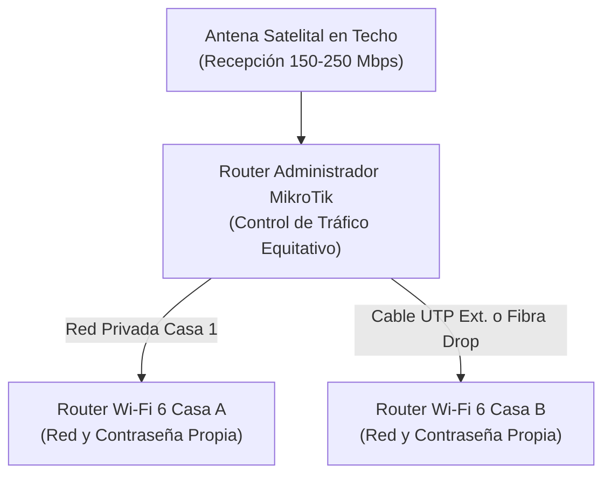

import { Image } from 'astro:assets';
import heroImage from '../../assets/accesorios/instalacion-internet-satelital-rural-chile-redes-parcelas/hero.jpg';
import FAQSection from '../../components/FAQSection.astro';

{/* =========================================================================
    1. NOTA LLAMATIVA AL PRINCIPIO CON IMAGEN Y SERVICIO EN LA 8ª REGIÓN
   ========================================================================= */}

  {/* Imagen Hero 16:9 con Badges Flotantes */}
  

    <Image
      src={heroImage}
      alt="Instalación profesional de antena satelital en parcela rural de la Región del Biobío, Chile"
      width={1000}
      height={563}
      format="webp"
      quality={90}
      class="w-full h-full object-cover"
      loading="eager"
      fetchpriority="high"
    />
    

    

      
        📍 Servicio en Terreno · Región del Biobío
      
      
        ⚡ 100 a 250 Mbps Reales
      
    

    

      
        Conectividad de Alta Velocidad para Parcelas y Campo
      
      <h2 class="text-xl sm:text-2xl md:text-3xl font-black text-white leading-tight drop-shadow-md m-0">
        Instalación Profesional de Internet Satelital en la 8ª Región
      </h2>
    

  

  {/* Tarjeta de Oferta y Beneficios Rápidos (Sin textos pesados) */}
  

    

      <h3 class="text-base sm:text-lg font-black text-white m-0">
        ¿Vives en una parcela o sector rural donde no llega la fibra y el 4G colapsa en las tardes?
      </h3>
      

        Realizamos visitas técnicas de evaluación, montaje en altura y distribución Wi-Fi en <strong>Florida, Yumbel, Santa Juana, Quillón, Concepción, Cabrero, Los Ángeles</strong> y alrededores.
      

    

    {/* 3 Cápsulas Visuales Clave */}
    

      

        ⚡
        <h4 class="font-bold text-white text-xs">Velocidad de Fibra</h4>
        

          100 a 250 Mbps sin cortes nocturnos. Ideal para teletrabajo y Netflix 4K.
        

      

      

        🤝
        <h4 class="font-bold text-emerald-300 text-xs">Paga a Medias (50/50)</h4>
        

          Comparte una sola antena con tu vecino contiguo y dividan la mensualidad.
        

      

      

        🛠️
        <h4 class="font-bold text-white text-xs">Llave en Mano</h4>
        

          Ponemos mástil para librar árboles, cable blindado de exterior y Wi-Fi 6 interior.
        

      

    

    {/* Botones de Acción Inmediatos */}
    

      <a
        href="https://wa.me/56931926886?text=Hola%20Luis,%20quiero%20cotizar%20la%20instalación%20de%20internet%20satelital%20en%20mi%20parcela."
        target="_blank"
        rel="noopener noreferrer"
        class="w-full sm:w-auto flex-1 py-3.5 px-6 rounded-xl bg-emerald-500 hover:bg-emerald-400 text-slate-950 font-black text-center text-xs sm:text-sm uppercase tracking-wider shadow-lg shadow-emerald-500/25 transition-all flex items-center justify-center gap-2"
      >
        📲 Consultar Factibilidad por WhatsApp (+56 9 3192 6886)
      </a>
      <a
        href="#modalidades-servicio"
        class="w-full sm:w-auto py-3.5 px-5 rounded-xl bg-slate-800 hover:bg-slate-700 text-slate-200 font-bold text-center text-xs transition-colors"
      >
        Ver Modalidades y Presupuestos ↓
      </a>
    

    {/* Aviso legal discreto al pie del bloque */}
    

      ⚖️ <em>Aviso legal: HogarTV.cl y Luis Briones prestan servicios técnicos independientes de ingeniería de redes, montaje y cableado. Starlink® es marca registrada de SpaceX. La cuota mensual oficial es contratada por el usuario con su propia tarjeta.</em>
    

  

---

{/* =========================================================================
    2. DESCRIPCIÓN DEL SERVICIO (MODALIDADES Y PRESUPUESTOS)
   ========================================================================= */}

## ¿Qué Incluyen Nuestras Instalaciones Llave en Mano?

No tienes que comprar herramientas especiales, trepar al techo con miedo a caerte ni complicarte configurando routers. Nosotros llevamos todos los insumos de intemperie y dejamos tu internet 100% operativo:

  

    

      Modalidad 1
    

    <h3 class="text-base font-extrabold text-white m-0">🏡 Parcela Individual</h3>
    

      Diseñada para una sola vivienda. Incluye montaje de antena en mástil elevado para esquivar copas de árboles, cableado exterior blindado y <strong>Router Wi-Fi 6 de alta cobertura</strong> para penetrar muros interiores.
    

    
✓ Cobertura total en dormitorios y living

  

  

    

      Modalidad 2 · Más Pedida
    

    <h3 class="text-base font-extrabold text-white m-0">🤝 Compartido Vecinos (UTP)</h3>
    

      Para 2 casas o parcelas contiguas separadas por hasta 80 metros. Una sola antena alimenta a dos viviendas mediante <strong>cable de red exterior con doble chaqueta UV</strong>. Cada casa tiene su propio Router Wi-Fi 6 independiente.
    

    
✓ Dividen el costo mensual a la mitad

  

  

    

      Modalidad 3
    

    <h3 class="text-base font-extrabold text-white m-0">🌲 Compartido Largo (Fibra Drop)</h3>
    

      Para parcelas alejadas entre 100 y 500 metros cruzando caminos interiores o bosque. Usamos <strong>fibra óptica drop monomodo dieléctrica</strong> con conversores ópticos: inmune a rayos eléctricos y con cero pérdida de velocidad.
    

    
✓ Cero caída de señal por distancia

  

{/* Módulo Especial de Seguridad Rural: Cámara en Portón Lejano */}

  

    

      
        📹 MÓDULO DE SEGURIDAD PERIMETRAL
      
      <h3 class="text-base sm:text-lg font-black text-white m-0">
        ¿Tienes una Cámara Lejos en la Entrada o Portón Principal?
      </h3>
    

    PoE o Drop Dedicado
  

  

    Uno de los problemas más frecuentes en parcelas del campo es que <strong>la tranquera o el portón de acceso está a 50, 100 o 300 metros de la casa</strong>. Llevar un cable eléctrico de 220V hasta allá sale carísimo. Con nuestro servicio de red en terreno solucionamos la alimentación y conectividad de tu cámara de dos formas según la distancia:
  

  

    

      

        <h4 class="font-bold text-white text-xs sm:text-sm m-0">🔌 Entrada a Menos de 100 Metros (Cable UTP + Inyector PoE)</h4>
        Hasta 90-100m
      

      

        Instalamos <strong>cable de red exterior blindado con chaqueta UV</strong> e incorporamos un <strong>Inyector PoE (Power over Ethernet)</strong> en el interior de tu casa. La cámara en el portón recibe <strong>energía eléctrica y datos de internet por el mismo cable de red</strong>. No necesitas enchufes ni cables de 220V en la entrada.
      

    

    

      

        <h4 class="font-bold text-white text-xs sm:text-sm m-0">⚡ Entrada a Más de 100 Metros (Fibra Drop Dedicada)</h4>
        100m a 500m+
      

      

        Cuando el portón está a 150m o 400m cruzando árboles, el cable de cobre convencional pierde señal y voltaje. En estos casos tiramos un <strong>cable de fibra drop monomodo dedicado hacia la entrada</strong> con conversores ópticos. La fibra es dieléctrica (inmune a rayos en tormentas) y te permite ver la cámara en vivo 2K/4K desde tu celular en cualquier lugar del mundo.
      

    

  

### Tabla de Proyectos y Presupuesto a la Medida

Dado que en los sectores rurales cada predio tiene distancias muy distintas (30m vs 300m, árboles altos o casas en loma), **no cobramos una tarifa plana rígida**, sino un **presupuesto personalizado** según la mano de obra e insumos de intemperie exactos:

| Modalidad de Conexión | Equipamiento y Alcance Técnico | Tipo de Enlace Recomendado | Presupuesto de Instalación |
| :--- | :--- | :--- | :--- |
| **Individual (1 Parcela / Casa)** | Antena satelital mini + 1 Router Wi-Fi 6 de alta penetración + Montaje en mástil y calibración. | Cobertura interior completa de la vivienda | **A Convenir** · Cotización según altura y terreno |
| **Compartido Vecinos (Cobre Blindado)** | Servicio para 2 casas contiguas + 2 Routers Wi-Fi 6 independientes + Conexión directa. | Cable de red UTP exterior UV blindado (hasta 80m) | **A Convenir** · Costo dividido entre familias |
| **Compartido Largo (Fibra Drop)** | Servicio para 2 parcelas alejadas + 2 Routers Wi-Fi 6 + Conversores de medios ópticos. | Fibra óptica drop monomodo (100m a 500m) | **A Convenir** · Inmune a rayos y distancia |
| **Compartido Premium (MikroTik)** | Enlace para 2 familias + 2 Routers Wi-Fi 6 + Router Administrador MikroTik con balanceo 50/50. | Cable exterior UTP o Fibra Drop dieléctrica | **A Convenir** · Ancho de banda garantizado |
| **Cámara en Portón Lejano (PoE / Drop)** | Enlace perimetral hacia la entrada. Inyector PoE (energía + datos sin enchufe 220V) o Drop óptico dedicado. | UTP exterior UV (hasta 100m) o Fibra Drop dedicada (más de 100m) | **A Convenir** · Monitoreo en tu celular 24/7 |

  

    

      📐 Evaluación Técnica en Terreno
    

    <h4 class="text-white font-extrabold text-base sm:text-lg m-0">¿Quieres saber el valor exacto para tu parcela?</h4>
    

      Indícanos tu comuna o sector rural y la distancia estimada. Te respondemos con la factibilidad técnica y tu cotización en menos de 24 horas.
    

  

  

    <a
      href="/contacto/?motivo=satelital-rural#contact-form"
      class="px-5 py-3 rounded-xl bg-emerald-500 hover:bg-emerald-400 text-slate-950 font-black text-xs uppercase tracking-wider transition-all shadow-lg shadow-emerald-500/25 flex items-center gap-1.5"
    >
      Cotizar Ahora →
    </a>
    <a
      href="https://wa.me/56931926886?text=Hola%20Luis,%20quiero%20cotizar%20la%20instalación%20de%20internet%20satelital%20en%20mi%20parcela."
      target="_blank"
      rel="noopener noreferrer"
      class="px-4 py-3 rounded-xl bg-slate-800 hover:bg-slate-700 text-emerald-400 border border-emerald-500/30 font-bold text-xs transition-all flex items-center gap-1.5"
    >
      💬 WhatsApp Técnico
    </a>
  

  *Nota sobre la mensualidad: El costo del plan de datos del proveedor satelital (aprox. $35.000 a $47.000 CLP mensuales según la modalidad contratada) es pagado directamente por el cliente al proveedor oficial mediante su tarjeta, sin contratos de amarre. En las opciones compartidas, ambos vecinos dividen este costo en partes iguales (aprox. $17.500 a $23.500 CLP/mes cada uno).

---

{/* =========================================================================
    3. DETALLE DE CÓMO FUNCIONA EL SISTEMA TÉCNICO
   ========================================================================= */}

## ¿Cómo Funciona la Conexión Compartida entre Dos Parcelas?

La pregunta más habitual de quienes evalúan compartir internet es: **"¿Qué pasa si mi vecino se pone a descargar cosas pesadas? ¿Se me caerá el internet a mí?"**.

La respuesta es **no**, siempre que la red se instale con un **administrador de tráfico MikroTik**:

### Los 3 Pilares del Control de Tráfico Profesional:

1. **Garantía 50% / 50%:** Si la antena recibe 200 Mbps, cada casa tiene asegurados 100 Mbps constantes. Nadie puede acaparar el canal del vecino.
2. **Prioridad Inteligente para Streaming:** El sistema le da paso preferente a las videollamadas de WhatsApp, Zoom y transmisiones de Smart TV (fútbol en vivo o películas) por sobre las descargas pesadas de fondo.
3. **Privacidad Total de Cada Hogar:** Cada casa cuenta con su propio nombre de red Wi-Fi y contraseña privada. Los dispositivos de una casa (computadores, celulares, cámaras de seguridad) están 100% aislados de la otra.

---

## Cable Exterior Blindado vs. Fibra Óptica Drop: ¿Cuál Necesitas?

Dependiendo del terreno y la distancia entre construcciones o hacia tu portón de entrada, la solución física cambia:

* **Cable UTP Exterior Blindado (Hasta 80-100 metros):**  
  Usamos cable Categoría 6 con doble chaqueta UV diseñado para soportar las heladas, la lluvia invernal del Biobío y el sol directo del verano. Es ideal si las casas están en el mismo predio o si quieres **alimentar una cámara en el portón con un inyector PoE**, llevando corriente y datos por el mismo cable sin necesidad de electricidad 220V en la entrada.
* **Fibra Óptica Drop Monomodo Dieléctrica (100 a 500 metros o más):**  
  Si las parcelas están separadas por un callejón, bosque o quebrada —o si tu portón está a 150m, 200m o 400m de la casa principal—, el cable de cobre convencional pierde velocidad, sufre caídas de voltaje y atrae tormentas eléctricas. La **fibra óptica drop dieléctrica no conduce electricidad (inmune a rayos)** y entrega exactamente los mismos 200 Mbps al vecino o a la cámara de seguridad perimetral sin importar la distancia.

---

## Recomendaciones en Terreno de Luis Briones (Biobío)

Como instalador con experiencia real en telecomunicaciones en la 8ª Región, estos son los cuatro puntos críticos que verificamos en cada visita:

1. **Línea de Vista Despejada:** Los satélites de baja órbita se desplazan rápido por el cielo. Una sola rama de pino o eucalipto que tape el cono norte provoca microcortes cada 10 minutos. Siempre montamos en mástil para superar la vegetación cercana.
2. **Cámaras en Portones sin Enchufes (Inyectores PoE):** Para no encarecer la obra tirando cables de corriente 220V hasta el portón, alimentamos las cámaras por el mismo cable de red exterior mediante PoE (Power over Ethernet) hasta 100m, o mediante una hebra de fibra drop dedicada para accesos lejanos.
3. **Protección Eléctrica Rural:** En comunas como Florida o Yumbel el voltaje suele fluctuar. Siempre recomendamos conectar la fuente a un pequeño regulador de voltaje o mini UPS para proteger los equipos y mantener internet en cortes de luz.
4. **Wi-Fi 6 Interior:** No sacas nada con tener 200 Mbps en el techo si tu router interior no traspasa las paredes de madera o adobe. Nuestros kits siempre incluyen routers Wi-Fi 6 de alta penetración.

---

export const satFaqs = [
  {
    question: "¿Es legal compartir el internet satelital con un vecino en Chile?",
    answer: "Técnicamente y en la práctica rural es una solución comunitaria muy extendida y viable cuando se realiza mediante enlaces privados de red dentro de predios o parcelas vecinas. La contratación del servicio satelital se registra a nombre de uno de los titulares y los costos de infraestructura y cuota mensual se distribuyen de común acuerdo entre las familias beneficiadas."
  },
  {
    question: "¿Pueden conectar una cámara de seguridad en el portón si está a 100 o 300 metros de la casa?",
    answer: "Sí, es uno de los trabajos más solicitados en parcelas del Biobío. Si el portón está a menos de 100 metros, instalamos cable de red exterior blindado UV con un Inyector PoE (Power over Ethernet): la cámara recibe energía eléctrica e internet por el mismo cable de red, sin tener que hacer una zanja con cables de 220V. Si la entrada está a más de 100 metros (ej. 150m a 500m), tiramos una hebra de fibra óptica drop dedicada con conversores ópticos, garantizando video fluido 2K/4K en vivo a tu celular e inmunidad total a tormentas eléctricas."
  },
  {
    question: "¿Qué pasa si se corta la luz en el sector rural?",
    answer: "La antena y los routers se apagan si no hay suministro. Sin embargo, al tener un consumo muy bajo (especialmente el modelo compacto Mini, que consume entre 25W y 40W), es muy fácil respaldar todo el sistema con una pequeña UPS o batería de 12V para mantener internet durante apagones de varias horas."
  },
  {
    question: "¿El clima del Biobío (lluvia densa o viento) afecta la señal?",
    answer: "Las antenas satelitales modernas cuentan con función integrada de derretimiento de nieve y resistencia a vientos de más de 90 km/h. Durante temporales muy densos puede existir una leve variación momentánea de la velocidad, pero la conexión se mantiene estable para streaming y trabajo."
  },
  {
    question: "¿En qué comunas de la 8ª Región realizan visitas de instalación?",
    answer: "Atendemos principalmente en Florida, Yumbel, Santa Juana, Quillón, Concepción, Talcahuano, San Pedro de la Paz, Chiguayante, Cabrero, Los Ángeles y comunas rurales aledañas de la Región del Biobío y Ñuble."
  }
];

## Preguntas Frecuentes sobre el Servicio Rural

<FAQSection
  title="Dudas Frecuentes de Vecinos y Parceleros"
  items={satFaqs}
/>

---

  🏡
  <h3 class="text-xl sm:text-2xl font-black text-white mb-2">
    ¿Quieres cotizar la instalación en tu parcela o casa de campo?
  </h3>
  

    Escríbenos directamente indicando tu comuna o sector rural del Biobío. Revisamos la visibilidad de tu terreno y te entregamos una propuesta a la medida, individual o compartida con tu vecino.
  

  

    <a
      href="https://wa.me/56931926886?text=Hola%20Luis,%20quiero%20consultar%20por%20la%20instalación%20de%20internet%20satelital%20en%20mi%20sector%20rural."
      target="_blank"
      rel="noopener noreferrer"
      class="w-full sm:w-auto px-7 py-3.5 rounded-xl bg-emerald-500 hover:bg-emerald-400 text-slate-950 font-black text-xs sm:text-sm uppercase tracking-wider transition-all shadow-lg shadow-emerald-500/25 flex items-center justify-center gap-2"
    >
      📲 Contactar por WhatsApp (+56 9 3192 6886)
    </a>
    <a
      href="/contacto/?motivo=satelital-rural#contact-form"
      class="w-full sm:w-auto px-6 py-3.5 rounded-xl bg-slate-800 hover:bg-slate-700 text-slate-200 font-bold text-xs transition-colors"
    >
      Formulario de Cotización Web →
    </a>
  

