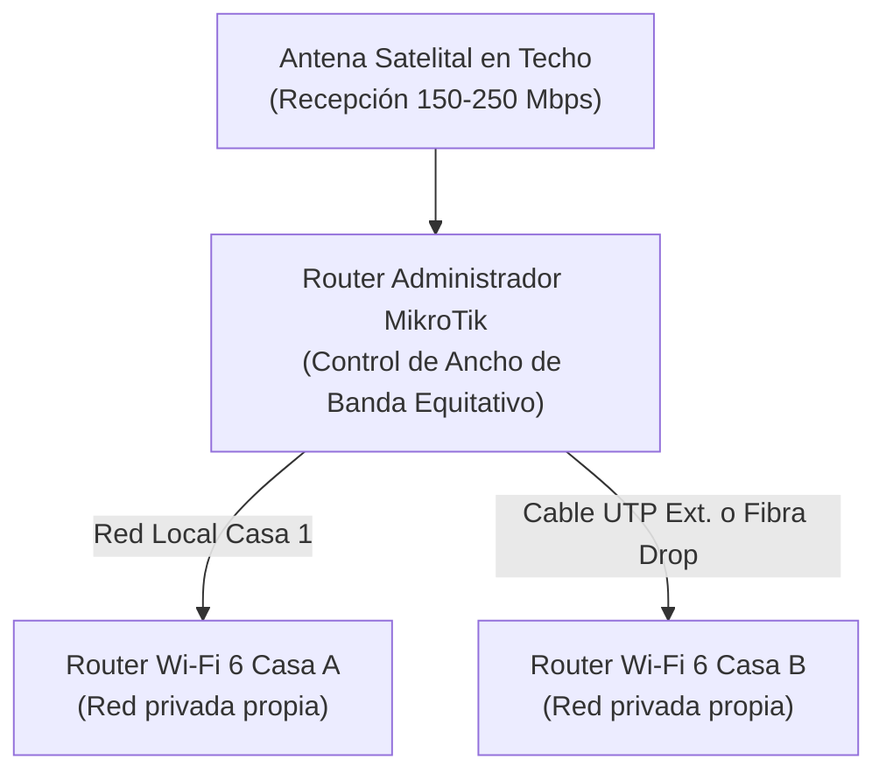

import FAQSection from '../../components/FAQSection.astro';
import CtaBanner from '../../components/CtaBanner.astro';

  

    ⚖️
    Aviso de Independencia Profesional y Marcas Registradas
  

  

    HogarTV.cl y el técnico Luis Briones prestan servicios independientes de ingeniería de redes, montaje en altura, cableado exterior y distribución Wi-Fi para hogares y parcelas en Chile. <strong>Starlink®</strong> es una marca registrada de Space Exploration Technologies Corp. (SpaceX). Este sitio no representa, no es distribuidor oficial ni mantiene afiliación corporativa con dicha empresa. La suscripción mensual del servicio de datos es contratada directamente por el usuario con el proveedor oficial.
  

{/* =========================================================================
    HERO DE CONVERSIÓN RÁPIDA (REGLA DE LOS 7 SEGUNDOS)
   ========================================================================= */}

  

    

      📡 SOLUCIÓN RURAL CHILE 2026
      Conectividad de Alta Velocidad en Parcelas
    

    ✓ Sin Límites de Cobertura 4G
  

  

    

      
Internet Satelital LEO de Baja Órbita

      <h2 class="text-xl sm:text-2xl font-extrabold text-white leading-tight mb-2">
        Internet de 100 a 250 Mbps en el Campo: ¿Conviene Solo o Compartido?
      </h2>
      

        En sectores rurales donde no llega la fibra óptica (Movistar, Mundo o Entel) y el 4G de los celulares se satura por las tardes, el internet satelital de baja órbita (como Starlink Mini o Standard) es la única solución real. Además, <strong>es posible compartir legalmente el enlace con una parcela vecina</strong> para dividir el costo mensual a la mitad sin perder velocidad.
      

      

        Velocidad 100-250 Mbps
        Baja Latencia (25-45 ms)
        Opción 50% / 50% con Vecino
      

    

    

      

        Instalación Llave en Mano
        Presupuesto a Medida según Terreno
      

      <a
        href="https://wa.me/56931926886?text=Hola%20Luis,%20leí%20tu%20artículo%20en%20HogarTV%20y%20me%20gustaría%20cotizar%20la%20instalación%20de%20internet%20satelital%20en%20mi%20parcela."
        target="_blank"
        rel="noopener noreferrer"
        class="w-full py-3 px-4 rounded-xl bg-emerald-500 hover:bg-emerald-400 text-slate-950 font-black text-center text-xs sm:text-sm shadow-lg shadow-emerald-500/20 transition-all flex items-center justify-center gap-2"
      >
        📲 Consultar Factibilidad por WhatsApp
      </a>
      <a
        href="#catalogo-proyectos"
        class="w-full py-1.5 px-3 rounded-lg bg-slate-800 hover:bg-slate-700 text-slate-300 font-semibold text-center text-xs transition-colors"
      >
        Ver Catálogo de Precios ↓
      </a>
    

  

## El Problema del Internet Rural en Chile y Por Qué el 4G Falla

Si vives o tienes una parcela de agrado en comunas rurales (como Florida, Yumbel, Santa Juana, Quillón, Pinto, Curacaví o el Valle del Elqui), conoces de sobra esta historia:

1. **La fibra óptica no llega:** Las empresas tradicionales no extienden tendidos de fibra donde hay pocas casas por kilómetro cuadrado.
2. **Los módems 4G o "BAM" colapsan:** Durante la mañana funcionan bien, pero entre las 19:00 y las 23:00 hrs la antena celular del pueblo se satura y la velocidad cae a menos de 2 Mbps, haciendo imposible ver Netflix, YouTube o trabajar en videollamadas.
3. **El internet satelital tradicional (Geoestacionario) era inviable:** Antiguas tecnologías satelitales tenían más de 600 ms de latencia (delay) y límites mensuales de descarga de 30 o 50 GB.

La llegada de los satélites de **órbita baja (LEO)** cambió este panorama radicalmente: al orbitar a solo 550 km de la Tierra, ofrecen **velocidades reales de 100 a 250 Mbps** y latencias de 25 a 45 ms, idénticas a las de una conexión urbana.

---

## Modalidades de Conexión y Proyectos "Llave en Mano"

Cada parcela o terreno rural presenta desafíos técnicos particulares: la distancia entre viviendas puede variar desde 30 metros hasta más de 300 metros cruzando caminos interiores o bosque; la altura necesaria del mástil para librar la copa de árboles no siempre es la misma; y los requerimientos de puntos de acceso Wi-Fi dependen de la estructura de cada casa.

Por estas razones, **no aplicamos tarifas rígidas estándar**, sino que estructuramos **un presupuesto a la medida exacta de tu terreno** (considerando únicamente los insumos de intemperie requeridos y la mano de obra de calibración):

| Modalidad de Conexión | Equipamiento y Alcance Técnico | Tipo de Enlace Recomendado | Presupuesto de Instalación |
| :--- | :--- | :--- | :--- |
| **Individual (1 Parcela / Casa)** | Antena satelital mini + 1 Router Wi-Fi 6 de alta penetración + Montaje en mástil y calibración azimutal. | Cobertura interior completa de la vivienda | **A Convenir** · Cotización según altura y terreno |
| **Compartido Vecinos (Cobre Blindado)** | Servicio para 2 casas contiguas + 2 Routers Wi-Fi 6 independientes + Conexión directa. | Cable de red UTP exterior UV blindado (hasta 80m) | **A Convenir** · Dividido entre ambas familias |
| **Compartido Largo (Fibra Drop)** | Servicio para 2 parcelas alejadas + 2 Routers Wi-Fi 6 + Conversores de medios ópticos. | Fibra óptica drop monomodo dieléctrica (100m a 500m) | **A Convenir** · Inmune a rayos y caídas de señal |
| **Compartido Premium (MikroTik)** | Enlace para 2 familias + 2 Routers Wi-Fi 6 + Router Administrador MikroTik con balanceo 50/50. | Cable exterior UTP o Fibra Drop dieléctrica | **A Convenir** · Garantía de ancho de banda equitativo |

  

    

      📐 Evaluación Técnica en Terreno
    

    <h4 class="text-white font-extrabold text-base sm:text-lg m-0">¿Quieres saber el presupuesto exacto para tu parcela?</h4>
    

      Indícanos tu comuna o localidad rural y la distancia estimada entre construcciones. Te responderemos con la factibilidad técnica y una cotización personalizada.
    

  

  

    <a
      href="/contacto/?motivo=servicio-tecnico"
      class="px-5 py-3 rounded-xl bg-emerald-500 hover:bg-emerald-400 text-slate-950 font-black text-xs uppercase tracking-wider transition-all shadow-lg shadow-emerald-500/25 flex items-center gap-1.5"
    >
      Cotizar Ahora →
    </a>
    <a
      href="https://wa.me/56931926886?text=Hola%20Luis,%20quiero%20cotizar%20la%20instalación%20de%20internet%20satelital%20en%20mi%20parcela."
      target="_blank"
      rel="noopener noreferrer"
      class="px-4 py-3 rounded-xl bg-slate-800 hover:bg-slate-700 text-emerald-400 border border-emerald-500/30 font-bold text-xs transition-all flex items-center gap-1.5"
    >
      💬 WhatsApp Técnico
    </a>
  

  *Nota sobre la mensualidad: El costo del plan de datos del proveedor satelital (aprox. $35.000 a $47.000 CLP mensuales según la modalidad residencial o itinerante) es pagado directamente por el cliente al proveedor oficial mediante su propia tarjeta de crédito o débito, sin contratos de amarre. En las modalidades compartidas, ambos vecinos dividen este abono oficial en partes iguales (aprox. $17.500 a $23.500 CLP/mes cada uno).

---

## ¿Cómo Funciona la Conexión Compartida entre Dos Casas o Parcelas?

La opción más demandada en sectores rurales es el **proyecto compartido entre dos vecinos o familiares que viven en el mismo terreno o parcelas contiguas**. 

Pagar \$47.000 CLP mensuales de forma individual puede representar un gasto elevado para un presupuesto familiar; sin embargo, al compartir el enlace, **cada casa termina pagando entre \$17.500 y \$23.500 CLP al mes**, lo que resulta **más barato que un plan de internet hogar tradicional en la ciudad**.

### ¿Por qué es indispensable un router MikroTik en la opción Premium?

El error común que cometen quienes intentan compartir internet por su cuenta con un simple switch o cable directo es que **no existe control de tráfico**:
* Si el vecino de la Casa 1 se pone a descargar un videojuego pesado o sincronizar archivos a la nube, absorbe el 95% del canal satelital.
* Como consecuencia, la Casa 2 sufre congelamientos en Smart TV, lag en llamadas de WhatsApp y caídas de Zoom.

En la **Modalidad Compartida Premium**, instalamos un router **MikroTik configurado con colas de tráfico avanzadas (PCQ / Simple Queues)**:
1. **Garantía 50% / 50%:** Cada casa tiene asignado su propio ancho de banda independiente.
2. **Priorización de Tráfico Inteligente:** Las videollamadas, el audio y las transmisiones de streaming tienen prioridad automática sobre las descargas pesadas de fondo.
3. **Privacidad Total de Red:** Cada casa tiene su propia red Wi-Fi y contraseña aislada; los dispositivos de una casa no pueden ver ni acceder a las computadoras, cámaras o teléfonos de la otra.

---

## Cable de Red Exterior vs. Fibra Óptica Drop: ¿Cuál Necesitas?

Dependiendo de la distancia que separe ambas viviendas, la solución técnica varía:

### Opción A: Cable de Red UTP Exterior Blindado (Hasta 80 metros)
* Se utiliza cable UTP Categoría 6 con doble chaqueta UV diseñado para resistir sol, lluvia y heladas extremas.
* Ideal si las casas están dentro del mismo predio o separadas por un patio o jardín corto.
* No requiere conversores eléctricos adicionales.

### Opción B: Enlace por Fibra Óptica Drop Dieléctrica (Distancias de 100 a 500 metros)
* Si las parcelas están separadas por un callejón, bosque o distancias mayores a 100 metros, el cable de cobre convencional pierde señal y atrae descargas eléctricas de tormentas.
* La **fibra óptica drop dieléctrica** no conduce electricidad (inmune a rayos), no sufre pérdidas por distancia y garantiza que la segunda vivienda reciba exactamente los mismos 200 Mbps que la casa principal.

---

## La Experiencia en Terreno: Recomendaciones Técnicas de Luis Briones

Como instalador en terreno en la Región del Biobío, estos son los tres puntos críticos que siempre verificamos antes de fijar cualquier soporte:

1. **Línea de Vista Despejada (Cero Obstrucciones):**  
   Los satélites de baja órbita se mueven a miles de kilómetros por hora por el cielo. Una sola rama de eucalipto o pino que tape el cono norte de visibilidad genera microcortes de 5 a 10 segundos cada 15 minutos. Siempre montamos la antena sobre mástiles elevados con anclaje perimetral para superar copas de árboles cercanas.
2. **Protección Eléctrica:**  
   En zonas rurales el voltaje fluctúa constantemente. Siempre recomendamos conectar la fuente del sistema satelital a un pequeño regulador de voltaje o UPS para proteger el equipo ante bajas de tensión o cortes de luz repentinos.
3. **Distribución Wi-Fi 6 en el Interior:**  
   La antena satelital recibe el internet del cielo, pero si el router interior es antiguo o tiene paredes de adobe/madera gruesa entremedio, la señal no llegará a los dormitorios. Por eso nuestros paquetes incluyen **routers Wi-Fi 6 de alta penetración** para garantizar cobertura total en toda la casa.

---

export const satFaqs = [
  {
    question: "¿Es legal compartir el internet satelital con un vecino en Chile?",
    answer: "Técnicamente y en la práctica rural es una solución comunitaria muy extendida y viable cuando se realiza mediante enlaces privados de red dentro de predios o parcelas vecinas. La contratación del servicio satelital se registra a nombre de uno de los titulares y los costos de infraestructura y cuota mensual se distribuyen de común acuerdo entre las familias beneficiadas."
  },
  {
    question: "¿Qué pasa si se corta la luz en el sector rural?",
    answer: "La antena y los routers se apagan si no hay suministro. Sin embargo, al tener un consumo muy bajo (especialmente el modelo Starlink Mini, que consume entre 25W y 40W), es muy fácil respaldar todo el sistema con una pequeña UPS o batería de 12V para mantener internet durante apagones de varias horas."
  },
  {
    question: "¿El clima de Chile (lluvia, viento o nieve) afecta la velocidad satelital?",
    answer: "Las antenas satelitales modernas cuentan con función integrada de derretimiento de nieve y resistencia a vientos de más de 90 km/h. Durante lluvias torrenciales muy densas puede existir una leve atenuación momentánea de la velocidad, pero la conexión se mantiene estable para streaming y trabajo."
  },
  {
    question: "¿Cuál es el costo mensual que se debe pagar a la compañía satelital?",
    answer: "En Chile, los planes residenciales de internet satelital de baja órbita oscilan habitualmente entre los $35.000 y $47.000 CLP mensuales (según el tipo de plan y equipo contratado). Este cobro es directo y sin contratos de amarre; puedes pausarlo o cancelarlo cuando quieras."
  },
  {
    question: "¿En qué zonas realizan instalaciones presenciales llave en mano?",
    answer: "Realizamos visitas técnicas de evaluación, montaje y cableado en toda la Región del Biobío y comunas aledañas (Concepción, Florida, Yumbel, Santa Juana, Quillón, Coronel, Los Ángeles, Cabrero y alrededores). Para otras regiones, entregamos asesoría y kits preconfigurados listos para instalar."
  }
];

## Preguntas Frecuentes sobre Internet Satelital Rural en Chile

<FAQSection
  title="Dudas Comunes sobre Instalación y Redes Satelitales"
  items={satFaqs}
/>

---

  🏡
  <h3 class="text-xl font-black text-white mb-2">
    ¿Quieres cotizar la instalación en tu parcela o casa de campo?
  </h3>
  

    Escríbenos directamente indicando tu comuna o sector rural. Revisamos la visibilidad satelital de tu terreno y te entregamos una propuesta a la medida, individual o compartida con tu vecino.
  

  

    <a
      href="https://wa.me/56931926886?text=Hola%20Luis,%20quiero%20consultar%20por%20la%20instalación%20de%20internet%20satelital%20en%20mi%20sector%20rural."
      target="_blank"
      rel="noopener noreferrer"
      class="px-6 py-3 rounded-xl bg-emerald-500 hover:bg-emerald-400 text-slate-950 font-black text-xs sm:text-sm uppercase tracking-wider transition-all shadow-lg shadow-emerald-500/25 flex items-center gap-2"
    >
      📲 Contactar por WhatsApp (+56 9 3192 6886)
    </a>
    <a
      href="/contacto/?motivo=servicio-tecnico#contact-form"
      class="px-5 py-3 rounded-xl bg-slate-800 hover:bg-slate-700 text-slate-200 font-bold text-xs transition-colors"
    >
      Formulario de Contacto / Cotización Web →
    </a>
  

