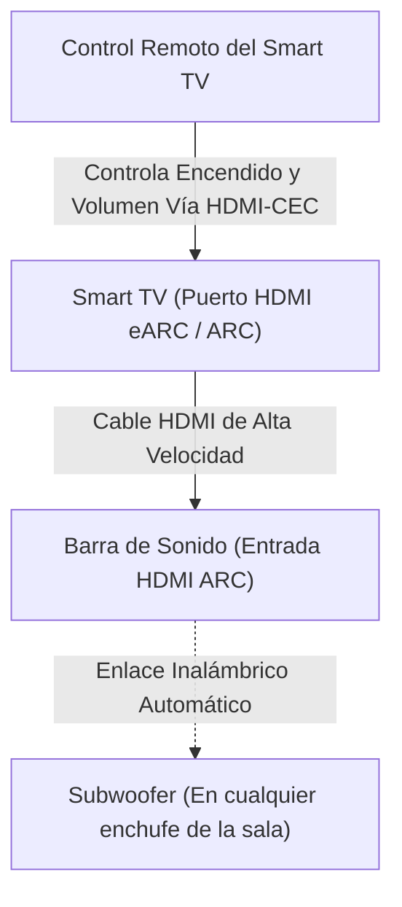

import ProductCard from '../../components/ProductCard.astro';
import ComparisonTable from '../../components/ComparisonTable.astro';
import FAQSection from '../../components/FAQSection.astro';
import AdSlot from '../../components/AdSlot.astro';
import CtaBanner from '../../components/CtaBanner.astro';

Los televisores modernos nunca se habían visto tan bien: son ultradelgados, tienen marcos invisibles y ofrecen resolución 4K asombrosa. Sin embargo, ese mismo diseño ultrafino tiene un gran sacrificado: **el sonido**.

Al tener un grosor de apenas un par de centímetros, los fabricantes no tienen espacio físico para montar altavoces con cajas de resonancia. El resultado son **voces apagadas, diálogos difíciles de entender en películas de acción y una ausencia total de frecuencias graves**, lo que te obliga a subir el volumen al máximo cada vez que hay una escena ruidosa.

Una **barra de sonido 2.1 con subwoofer inalámbrico independiente** es la mejora más barata y transformadora que puedes hacerle a tu Smart TV. En esta guía comparamos las opciones más vendidas y mejor valoradas en Chile por debajo de los **$180.000 CLP**.

---

## Comparativa Rápida: Las Mejores Opciones en Chile (2026)

<ComparisonTable
  title="Tabla Comparativa de Barras de Sonido 2.1 en Chile"
  headers={["Modelo", "Potencia Total", "Subwoofer", "Conectividad", "Precio Est. (CLP)"]}
  rows={[
    { feature: "Samsung HW-B550 (Línea 2026)", values: ["410 Watts", "Inalámbrico Dedicado", "HDMI ARC + Óptico + BT", "$ 129.990 - $ 179.990"], productKey: "samsung-soundbar-b550" },
    { feature: "JBL Cinema SB170", values: ["220 Watts", "Inalámbrico Dedicado", "HDMI ARC + Óptico + BT", "$ 139.990 - $ 189.990"], productKey: "jbl-soundbar-sb170" },
    { feature: "Barra Compacta 2.0 Genérica", values: ["60 - 80 Watts", "Sin Subwoofer (Integrado)", "Auxiliar + Bluetooth", "$ 49.990 - $ 79.990"], productKey: "samsung-soundbar-b550" }
  ]}
  verdict="Para salas de estar y livings familiares, la Samsung HW-B550 es la ganadora indiscutida por su enorme potencia de 410W y su modo de realce de voz. Si buscas una firma acústica con graves ultra contundentes para música y cine en espacios medianos, la JBL Cinema SB170 es una joya."
/>

---

## 1. La Mejor en Relación Potencia/Precio: Samsung HW-B550 (410W)

Si buscas la barra de sonido más completa y potente sin gastar una fortuna, el modelo **HW-B550 de Samsung** es el punto óptimo del mercado chileno. Con 410 Watts de potencia y soporte para **Dolby Audio y DTS Virtual:X**, llena cualquier living chileno sin distorsionar.

<ProductCard
  productKey="samsung-soundbar-b550"
  isFirst={true}
  title="Barra de Sonido Samsung HW-B550 2.1ch con Subwoofer Inalámbrico 410W"
  brand="Samsung"
  badge="🏆 La Mejor Barra Calidad / Precio en Chile"
  specs={["Potencia 410W", "Subwoofer Inalámbrico", "Dolby Audio / DTS Virtual:X", "HDMI ARC & Óptico", "Modo Bass Boost", "Voice Enhance"]}
  pros={[
    "410 Watts reales con subwoofer inalámbrico que puedes colocar en cualquier rincón del living",
    "Función Voice Enhance: aclara las conversaciones para no perderte ningún diálogo en películas o teleseries",
    "Conexión HDMI ARC: enciende, apaga y sube el volumen con el mismo control remoto de tu televisor",
    "Modo Juego optimizado que sincroniza el audio direccional con tu consola de videojuegos"
  ]}
  cons={[
    "No cuenta con asistente de voz por WiFi (la transmisión inalámbrica se realiza vía Bluetooth 4.2)"
  ]}
/>

### ¿Por qué la recomendamos para hogares chilenos?
Lo mejor de la Samsung HW-B550 es su equilibrio. A diferencia de las barras baratas sin subwoofer, este equipo separa los canales: la barra delgada se encarga de los agudos y medios (las voces), mientras que el cajón del subwoofer se encarga exclusivamente de las explosiones, bandas sonoras y graves. Además, al ser inalámbrico, **no necesitas tirar ningún cable a través del piso**: solo lo enchufas a la toma de corriente y se empareja solo.

<AdSlot format="in-feed" label="Ofertas Recomendadas de Audio" />

---

## 2. Para Amantes de los Bajos y el Cine: JBL Cinema SB170

La marca norteamericana JBL es legendaria en el mundo del audio por su pegada en frecuencias bajas. La **JBL Cinema SB170** condensa esa experiencia en un diseño elegante y minimalista.

<ProductCard
  productKey="jbl-soundbar-sb170"
  title="Barra de Sonido JBL Cinema SB170 2.1 Canales con Subwoofer 220W"
  brand="JBL"
  badge="🎵 Graves Profundos y Fidelidad Acústica"
  specs={["Potencia 220W", "Subwoofer Inalámbrico", "Dolby Digital", "HDMI ARC", "Botón dedicado Voice", "Bluetooth 4.2"]}
  pros={[
    "Firma de audio JBL: sonido cálido y bajos con textura cinematográfica que hacen vibrar el sofá",
    "Botón dedicado 'Voice' en el control remoto para destacar voces al instante sin tocar ecualizadores",
    "Perfil ultra compacto que calza perfectamente bajo pantallas de 43, 50, 55 y 65 pulgadas",
    "Emparejamiento Bluetooth veloz para usarla como equipo de música principal con tu smartphone"
  ]}
  cons={[
    "Tiene menor potencia bruta (220W) que la Samsung, aunque su respuesta acústica es más precisa en espacios medianos"
  ]}
/>

---

## Guía de Conexión: Cómo Conectar tu Barra para Usar un Solo Control

Uno de los errores más comunes al comprar una barra de sonido en Chile es conectarla por cable auxiliar de 3.5 mm o por Bluetooth directo al televisor. Hacer esto genera retrasos de audio (*lag*) y te obliga a usar dos controles distintos.

Sigue estos pasos para la instalación perfecta:

1. **Usa el puerto HDMI ARC / eARC:** Busca en la parte trasera de tu televisor el puerto HDMI rotulado con las siglas **ARC** (Audio Return Channel).
2. **Conecta un cable HDMI 2.0:** Conéctalo desde ese puerto hacia la entrada HDMI de la barra.
3. **Activa HDMI-CEC en los ajustes de tu TV:**
   - En **Samsung**: se llama *Anynet+*.
   - En **LG**: se llama *SimpLink*.
   - En **TCL / Google TV**: se llama *Control HDMI (CEC)*.
   - En **Sony**: se llama *Bravia Sync*.

Al hacer esto, **la barra de sonido se encenderá automáticamente cuando prendas el televisor y podrás regular el volumen con el mismo control remoto de la tele**, olvidándote de controles adicionales.

---

## Preguntas Frecuentes sobre Barras de Sonido en Chile

export const audioFaqs = [
  {
    question: "¿Es mejor una barra 2.1 con subwoofer o una 2.0 integrada?",
    answer: "Siempre es superior una barra 2.1 con subwoofer externo. Las barras 2.0 compactas no tienen suficiente espacio físico para reproducir frecuencias por debajo de 80Hz, por lo que el sonido sigue sintiéndose plano. El subwoofer dedicado marca el 80% de la diferencia en la experiencia de cine en casa."
  },
  {
    question: "¿Puedo usar la barra de sonido para escuchar música desde mi celular?",
    answer: "Sí. Todos los modelos que recomendamos incluyen conectividad Bluetooth. Solo presionas el botón de Bluetooth en el control de la barra, buscas el dispositivo en tu teléfono (Spotify, YouTube Music, Apple Music) y disfrutas de audio de alta fidelidad."
  },
  {
    question: "¿Funciona una barra de sonido Samsung con un televisor LG, TCL o Hisense?",
    answer: "Sí, 100% compatible. El estándar HDMI ARC y la salida de audio digital óptica son universales en la industria. Una barra Samsung o JBL funcionará a la perfección con cualquier televisor que tenga entrada HDMI o puerto óptico."
  },
  {
    question: "¿Dónde conviene ubicar el subwoofer inalámbrico en la habitación?",
    answer: "Dado que las ondas graves no son direccionales para el oído humano, puedes colocar el subwoofer en cualquier lugar del living cerca de un enchufe: en una esquina, al lado del sillón o junto al mueble de la televisión. Ubicarlo cerca de una esquina suele amplificar ligeramente los graves de forma natural."
  }
];

<FAQSection
  title="Preguntas Frecuentes sobre Barras de Sonido en Chile"
  items={audioFaqs}
/>

<CtaBanner
  title="Equipa tu sala con el mejor sonido para Smart TV"
  description="Explora nuestras barras y soportes seleccionados con despacho directo a todo Chile."
  buttonText="Ver Tienda de Recomendados"
  buttonUrl="/recomendados/#seccion-audio-accesorios"
/>
